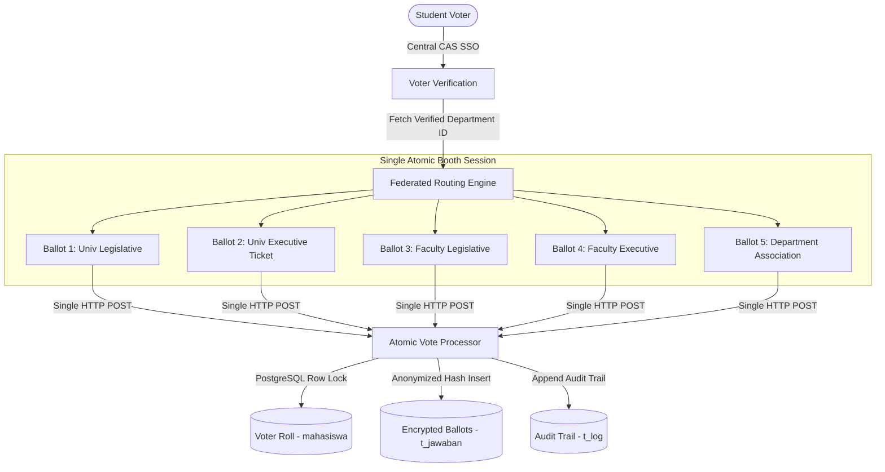

# CampusBallot Core

[](https://www.php.net/)
[](https://www.postgresql.org/)
[](LICENSE)
[](#architecture-overview)

A battle-tested, high-concurrency electronic voting platform engineered for large-scale university student federations (39,000+ eligible voters). 

Originally developed in 2020 and continuously modernized through 2025/2026, **CampusBallot Core** solves the acute challenges of collegiate democracy: multi-tier federated ballot delivery, zero-loss double-voting prevention under peak flash crowds, and dual-key cryptographic ceremonial ballot unlocking.

---

## 🏛️ The Engineering Challenge: Federated Collegiate Elections

A collegiate election is never a single monolithic ballot; it is a **federation of concurrent elections** occurring simultaneously:

| Ballot Tier | Democratic Scope | Level | Selection Rule |
| :--- | :--- | :--- | :--- |
| **Tier 1 (Bilik 1)** | University Legislative Council | Legislative (Univ) | Faculty Constituency Seat |
| **Tier 2 (Bilik 2)** | University Student Executive Board | Executive (Univ) | Universal Presidential & Vice-Presidential Ticket |
| **Tier 3 (Bilik 3)** | Faculty Legislative Council | Legislative (Faculty) | Faculty-wide or Departmental Seat |
| **Tier 4 (Bilik 4)** | Faculty Executive Board | Executive (Faculty) | Faculty-wide Executive Pair |
| **Tier 5 (Bilik 5)** | Department Student Association (HIMA) | Departmental | Program-specific Association Leadership |

When a student authenticates, the system must deterministically route and deliver up to **5 distinct ballot papers** in a single atomic transaction based on their authoritative institutional enrollment.



---

## 🚀 Key Architectural Highlights

### 1. The Breakdown of String Heuristics & Deterministic Department Mapping
Legacy systems historically parsed student IDs (NIM) using character offsets (e.g. `substr($id, 2, 1)` to derive faculty code `1` through `7`). This heuristic catastrophically failed when new faculties were established with multi-digit codes (e.g., Faculty of Medicine `10`, Faculty of Psychology `11`, Faculty of Law `12`), causing medical students to be mistakenly routed to education faculty ballots.

**The Fix:** CampusBallot Core replaced all string slicing with an **authoritative relational mapping engine**. Upon SSO authentication, the student's verified `id_jurusan` is read directly from institutional records and mapped deterministically against ballot definitions in `pertanyaan`, guaranteeing 100% routing accuracy regardless of student ID formatting changes.

### 2. High-Concurrency Zero-ORM Architecture
During university elections, traffic does not arrive evenly—it spikes in massive surges when classes break, generating thousands of concurrent HTTP requests within seconds.
* Heavy full-stack ORM frameworks incur severe overhead bootstrapping service containers and hydrating complex object trees.
* CampusBallot Core uses **optimized native PHP with direct parameterized PostgreSQL queries**, achieving sub-15ms response times.
* Double-voting prevention is enforced at the database layer using transactional row-level locks (`SELECT status FROM mahasiswa WHERE nim = $1 FOR UPDATE`) rather than relying on error-prone application-layer memory flags.

### 3. Dual-Key Plenary Unlock Mechanism (`system/tabulation/`)
To preserve real-world electoral integrity and prevent early leaking of candidate vote tallies before polling closes:
* The live count dashboard remains cryptographically sealed until official closing.
* Unlocking requires **independent authentication keys from two distinct institutional authorities**:
  1. The **Election Commission (KPU)** Key
  2. The **Election Supervisory Board (BAWASLU)** Key
* Both independent keys must be submitted simultaneously to transition the ballot box state to unlocked.

### 4. Real-Time Turnout Telemetry (`system/telemetry/turnout.php`)
* Displays public participation metrics across all faculties.
* Computed synchronously from live ballot activity with zero caching lag, providing instant voter turnout transparency without revealing candidate vote counts.

---

## 📂 Project Structure

```text
campus-evoting-engine/
├── .env.example                 # Environment configuration template
├── .gitignore                   # Strict protection rules (ignores credentials & voter dumps)
├── composer.json                # Modern Composer dependency definition
├── docker-compose.yml           # Instant local development container stack
├── README.md                    # Project documentation
│
├── database/
│   ├── schema.sql               # Pristine normalized PostgreSQL DDL (12 tables + indexes)
│   └── seed_demo.sql            # Demo seed data (faculties, candidates, unlock keys)
│
├── docs/
│   ├── ARCHITECTURE.md          # In-depth architectural specification
│   └── SECURITY_AUDIT.md        # Threat model & forensic audit report
│
└── public_html/                 # Web root directory
    ├── index.php                # System portal & module navigator
    ├── assets/                  # Core frontend assets (Bootstrap 5, fonts)
    ├── images/                  # Open-source branding & SVG logos
    │
    └── system/                  # Core Voting Engine Subsystems
        ├── db_connect.php       # Centralized environment-driven database handler
        ├── healthcheck.php      # JSON health & latency probe for load balancers
        │
        ├── booth/               # Voting Booth Subsystem
        │   ├── index.php        # Booth intake & rules
        │   ├── ballot.php       # Single-page atomic 5-ballot routing engine
        │   ├── completed.php    # Post-vote lock and session clearance
        │   └── candidates/      # SVG mock candidate portraits
        │
        ├── tabulation/          # Tabulation & Plenary Unlocking Subsystem
        │   ├── index.php        # Plenary session selector
        │   ├── results.php      # Candidate tally dashboard & comparative charts
        │   ├── unlock.php       # Dual-Key authorization portal
        │   └── process_unlock.php # Dual-Key validation processor
        │
        ├── telemetry/           # Real-Time Turnout Telemetry
        │   └── turnout.php      # Live participation monitor per faculty
        │
        ├── verification/        # SSO Intake & Token Generation
        │   ├── Cas.php          # Composer-backed phpCAS client wrapper
        │   ├── index.php        # SSO callback & voter eligibility verification
        │   ├── token.php        # Token generation & handover
        │   └── notify.php       # Notification dispatcher
        │
        └── admin/               # Administrative & Reset Utilities
            ├── search.php       # Voter roll search utility
            ├── search_form.html # Search user interface
            ├── reset_ballot.php # Supervised ballot reset handler (recovery)
            └── reset_form.html  # Reset user interface
```

---

## 🛠️ Quickstart & Local Setup

### Option A: Running with Docker Compose (Recommended)

1. **Clone the repository:**
   ```bash
   git clone https://github.com/mauliv/campus-evoting-engine.git
   cd campus-evoting-engine
   ```

2. **Start the containers:**
   ```bash
   docker compose up -d
   ```
   *Automatically launches PHP 8.2 Apache on port `8080` and PostgreSQL 16 on port `5432`, pre-seeded with `schema.sql` and `seed_demo.sql`.*

3. **Open the application:**
   Navigate to [http://localhost:8080](http://localhost:8080) in your browser.

---

### Option B: Native Host Environment (PHP 8.0+ & PostgreSQL)

1. **Install dependencies:**
   ```bash
   composer install
   ```

2. **Configure environment:**
   ```bash
   cp .env.example .env
   # Edit .env with your PostgreSQL credentials
   ```

3. **Initialize the database:**
   ```bash
   psql -U postgres -d evoting_db -f database/schema.sql
   psql -U postgres -d evoting_db -f database/seed_demo.sql
   ```

4. **Serve locally:**
   ```bash
   php -S 127.0.0.1:8080 -t public_html/
   ```

---

## 🧪 Demo Credentials & Testing

The demo seed script (`database/seed_demo.sql`) provisions the following testing records:

* **Dual-Key Plenary Unlock Keys:**
  * **Election Commission (KPU):** `KPU_KEY_2026`
  * **Supervisory Board (BAWASLU):** `BAWASLU_KEY_2026`
* **Demo Student Voters:**
  * Engineering Student: `22501001` (`student.a@campus.edu`)
  * Medical Student: `23101002` (`student.b@campus.edu`)
* **Healthcheck Probe:**
  * Visit `http://localhost:8080/system/healthcheck.php` to verify database ping, latency, and runtime environment.

---

## 🗺️ Roadmap & Continuous Evolution

Designed as an evolving real-world project, the roadmap welcomes contributions across:

- [ ] **Unit & Integration Test Suite:** Comprehensive test coverage via Pest PHP / PHPUnit mocking CAS and database state.
- [ ] **Cryptographic Audit Chain:** Merkle tree / SHA-256 hash chaining of cast ballots for verifiable end-to-end auditability.
- [ ] **Modern PSR-7 Routing:** Refactoring procedural endpoints into clean controllers with middleware pipeline.
- [ ] **Automated Load Testing:** k6 & Locust benchmark scripts simulating 10,000 concurrent voter bursts.

---

## 📄 License
This project is open-sourced under the **MIT License**.
